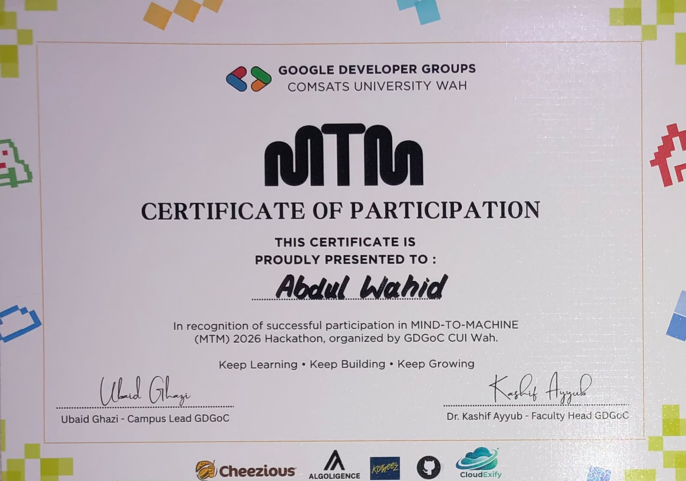

# MTM Hackathon V2 — Mind-to-Machine ('26)

> **Abdul Wahid** has successfully participated in the MTM — Mind-to-Machine (MTM) 2026 Hackathon

---

## 📋 Certificate Details

| Detail | Info |
|---|---|
| **Certificate Type** | Certificate of Participation |
| **Event Name** | MTM Hackathon '26 — Mind-to-Machine (V2) |
| **Issued To** | Abdul Wahid |
| **Date** | November 18, 2026 |
| **Organized By** | Google Developer Groups — COMSATS University Wah Campus |
| **Status** | Participation Verified |
| **Signed By** | Ubaid Ghazi (Campus Lead GDGoC) & Dr. Kashif Ayyub (Faculty Head GDGoC) |
| **Verify** | [🔗 View Certificate](https://drive.google.com/file/d/1yhjiMAYIJWojUvCZs7UZu_GNtH4UBVXy/view?usp=share_link) |

---

## 🏆 About the Event

**MTM (Mind-to-Machine)** is an AI hackathon organized by Google Developer Groups at COMSATS University Wah Campus. In the 2026 edition, teams had one day to build an AI agent system that reads a pack of scattered messages — emails, WhatsApp texts and notices in English and Roman Urdu — and plans a complete 4-hour hackathon: venue, schedule, food, judging and budget.

**Team AXIONS** (GDG On Campus CUI Attock) — Abdul Wahid (lead + presenter), Abdul Moiz and Jawad Hassan — built a planner where the language model only reads and extracts facts, while every planning decision, figure and validation check runs in deterministic code. A message that would break a validated plan is rejected, with the reason shown.

- 💻 **Project repository:** [github.com/abduIwahid/mtm-hackathon-26](https://github.com/abduIwahid/mtm-hackathon-26)
- 🌐 **Live web app:** [mtm-hackathon-26.vercel.app](https://mtm-hackathon-26.vercel.app)

---

## 🤝 Sponsors & Partners

| Partner | Role |
|---|---|
| **Cheezious** | Sponsor |
| **Algoligence** | Partner |
| **GitHub** | Partner |
| **CloudExify** | Partner |

---

## 🧠 Skills Demonstrated

- ✅ AI agent system design (model reads, code decides)
- ✅ Deterministic planning, validation and transactional updates
- ✅ Team leadership and live presentation
- ✅ Building a complete product under hackathon time limits
- ✅ Teamwork and collaboration

---

## 🏫 Organizer

**Google Developer Groups (GDGoC)**
COMSATS University Wah Campus

| Role | Name |
|---|---|
| Campus Lead GDGoC | Ubaid Ghazi |
| Faculty Head GDGoC | Dr. Kashif Ayyub |

---

## 🔍 Verify Certificate

**🔗 [https://drive.google.com/file/d/1yhjiMAYIJWojUvCZs7UZu_GNtH4UBVXy/view?usp=share_link](https://drive.google.com/file/d/1yhjiMAYIJWojUvCZs7UZu_GNtH4UBVXy/view?usp=share_link)**

---

  <i>📅 Event Date: November 18, 2026 &nbsp;|&nbsp; 🏅 Organized by GDGoC — COMSATS University Wah Campus</i>

